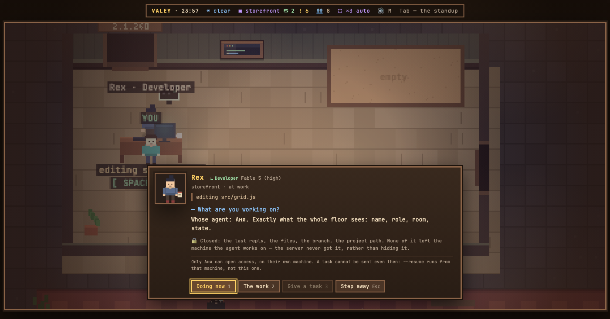

# v0.77.1 — 28 September 2026

## агенты участника на твоём этаже

*office*

Офис умел звать в гости человека, но не его агентов: приглашённый приходил на пустой этаж и смотрел на чужую работу со стороны. Теперь офис участника приезжает целиком — его агенты садятся за столы в комнатах твоего этажа, рядом с твоими.

Приезжает только проекция: имя, роль, комната, состояние. Последняя реплика, файлы, ветка и путь проекта не приходят вовсе — их не прячут, их просто не отправляют, и в этом разница. Задание чужому агенту не отправить даже так: `--resume` идёт с машины, где агент работает, а не с твоей.

Участник подключается одной командой у себя — `node modules/floor/join.mjs "<ссылка-приглашение>"`, — и его агенты появляются на этаже через такт. Отозвал приглашение — уехали на следующем. Панель со списком людей и запрос доступа к чужой работе рисуются отдельно: то, что вышло сейчас, — агенты за столами и их карточка.

Заодно офис перестал считать чужих агентов ждущими тебя: «!» в шапке, планёрка, ресепшен и первый экран зовут отвечать только там, где ответить можно.

## A teammate's agent no longer counts as waiting for you

<!-- fix -->

*office*

### What changed

### Fixed

- **office:** a teammate's agent no longer counts as waiting for you (9ce10ba)

### Other

- docs(notes): the release note for the shared floor, and an office raised for its picture (77d72fe)
- refactor(modules): the invitation trade is a function a module can call (1332ad6)
- chore(office): the card of an agent from another machine, and a module's own settings save (0e7d875)
- chore(modules): a seam for agents from another machine, sieved by the guest projection (18835d1)
