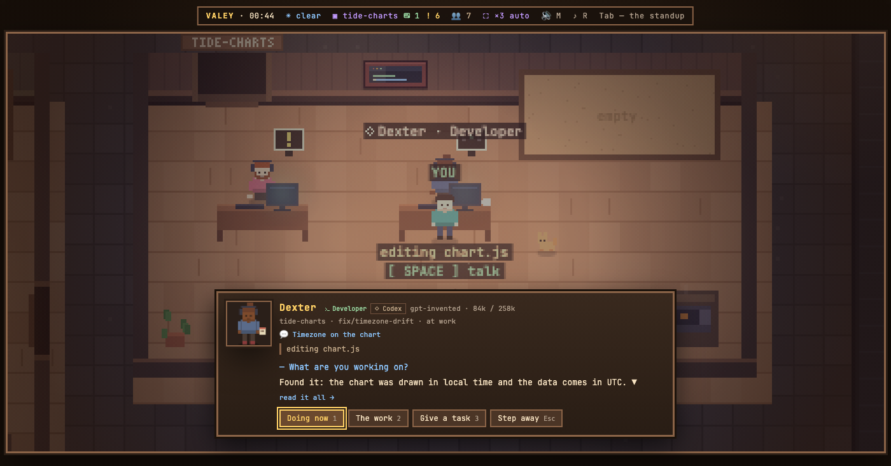

# v0.77.2 — 28 September 2026

## A Codex agent's card shows how full its context is, out of the window Codex reports

*office*

The card's model line has said how full a Claude agent's context is since the size first appeared, and a Codex agent's line stayed bare: the office read the Codex rollout for the model, the prompt and the tools, and passed over the token counts it writes after every request. It now reads them — what the last request was fed, cached part included — and the window comes from the same line, because a GPT model's name does not say how large it is. So the card reads «84k / 258k», and from 80% the bubble over the head grows its meter as it does for Claude.

## A Codex agent's card showed no context size — the rollout's token counts were never read

<!-- fix -->

*office*

### What changed

### Fixed

- **office:** a Codex agent's card showed no context size — the rollout's token counts were never read (277a0f5)

### Other

- docs(notes): the Codex card's context size, photographed on the demo floor (5af9a2b)
